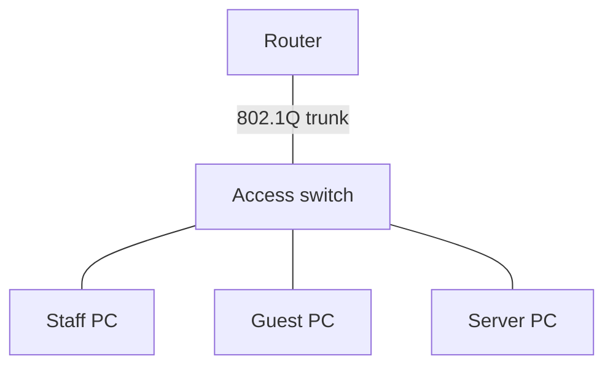

# Enterprise office segmentation

**Status:** Design and examples documented. Lab verification pending.

## Objective
Separate departmental broadcast domains while providing routed connectivity and automated addressing.

## Proposed topology


| VLAN | Department | Subnet | Gateway |
|---|---|---|---|
| 10 | Staff | 192.168.10.0/24 | 192.168.10.1 |
| 20 | Guest | 192.168.20.0/24 | 192.168.20.1 |
| 30 | Servers | 192.168.30.0/24 | 192.168.30.1 |

## Implementation checklist
- [ ] Build topology in Cisco Packet Tracer with a router, switch and three PCs.
- [ ] Configure access ports Fa0/1–3 for the corresponding VLANs.
- [ ] Configure an 802.1Q trunk and router subinterfaces.
- [ ] Configure DHCP scopes, reserving addresses .1 through .10.
- [ ] Save device configurations and Packet Tracer project.
- [ ] Verify DHCP and inter-VLAN connectivity.

## Verification
| Check | Expected result | Actual |
|---|---|---|
| show vlan brief | Correct port membership | Pending |
| show interfaces trunk | VLANs 10,20,30 carried | Pending |
| show ip dhcp binding | One lease per client | Pending |
| Ping between VLANs | Success before filtering | Pending |

Routing enables communication between VLANs; VLANs alone do not enforce access restrictions.

## Evidence
Add topology screenshot, sanitized configurations and actual test output here.

## Extension
Add a fourth management VLAN and test its addressing and connectivity.

## Sample Cisco IOS configurations

Connect PCs to SW1 Fa0/1 through Fa0/3 in VLAN order. Connect SW1 Gi0/1 to R1 Gi0/0. Set each PC to DHCP. Inter-VLAN traffic is allowed in this design.

### SW1 — VLANs and trunk

```text
enable
configure terminal
hostname SW1
vlan 10
 name STAFF
exit
interface fa0/1
 switchport mode access
 switchport access vlan 10
 spanning-tree portfast
exit
vlan 20
 name GUEST
exit
interface fa0/2
 switchport mode access
 switchport access vlan 20
 spanning-tree portfast
exit
vlan 30
 name SERVERS
exit
interface fa0/3
 switchport mode access
 switchport access vlan 30
 spanning-tree portfast
exit
interface gi0/1
 switchport mode trunk
 switchport trunk allowed vlan 10,20,30
exit
end
copy running-config startup-config
```

### R1 — Inter-VLAN routing and DHCP

```text
enable
configure terminal
hostname R1
interface g0/0
 no shutdown
exit
interface g0/0.10
 encapsulation dot1Q 10
 ip address 192.168.10.1 255.255.255.0
exit
ip dhcp excluded-address 192.168.10.1 192.168.10.10
ip dhcp pool STAFF
 network 192.168.10.0 255.255.255.0
 default-router 192.168.10.1
exit
interface g0/0.20
 encapsulation dot1Q 20
 ip address 192.168.20.1 255.255.255.0
exit
ip dhcp excluded-address 192.168.20.1 192.168.20.10
ip dhcp pool GUEST
 network 192.168.20.0 255.255.255.0
 default-router 192.168.20.1
exit
interface g0/0.30
 encapsulation dot1Q 30
 ip address 192.168.30.1 255.255.255.0
exit
ip dhcp excluded-address 192.168.30.1 192.168.30.10
ip dhcp pool SERVERS
 network 192.168.30.0 255.255.255.0
 default-router 192.168.30.1
exit
end
copy running-config startup-config
```

