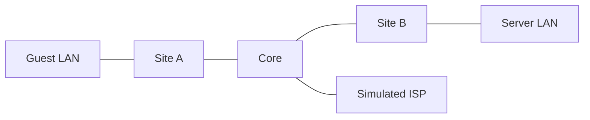

# Multi-site enterprise WAN

**Status:** Design and examples documented. Lab verification pending.

## Objective
Connect branch networks through dynamic routing, apply guest access restrictions and provide simulated external connectivity using PAT.



| Segment | Subnet | Assignments |
|---|---|---|
| Site A LAN | 10.1.20.0/24 | Router .1, client .10 |
| Site B LAN | 10.2.30.0/24 | Router .1, server .10 |
| Site A to Core | 10.0.12.0/30 | Site A .1, Core .2 |
| Core to Site B | 10.0.23.0/30 | Core .1, Site B .2 |
| Core to simulated ISP | 203.0.113.0/30 | ISP .1, Core .2 |

## Implementation checklist
- [ ] Build on Packet Tracer or GNS3 with licensed images.
- [ ] Assign interface addresses and enable links.
- [ ] Configure single-area OSPF with unique router IDs and passive LAN interfaces.
- [ ] Advertise a default route from the core.
- [ ] Verify baseline connectivity.
- [ ] Apply inbound guest ACL denying access to the server subnet and permitting other traffic.
- [ ] Configure PAT on the core's outside interface.
- [ ] Save configurations and test evidence.

## Verification
| Check | Expected result | Actual |
|---|---|---|
| show ip ospf neighbor | FULL adjacency on both core links | Pending |
| show ip route ospf | Remote LAN routes learned | Pending |
| Guest-to-server ping before ACL | Success | Pending |
| Guest-to-server ping after ACL | Blocked | Pending |
| show access-lists | Deny counter increases | Pending |
| Ping simulated ISP and show ip nat translations | Successful translation | Pending |

## Evidence
Add topology screenshot, sanitized router configurations, before/after tests and routing tables.

## Extension
Introduce a second OSPF area and document route types and the border router.

## Sample Cisco IOS configurations

Connect interfaces by matching the addressing table. Configure client `10.1.20.10/24` with gateway `10.1.20.1`, and server `10.2.30.10/24` with gateway `10.2.30.1`. The ISP router represents an isolated test endpoint with no return routes to the private LANs.

### Site A

```text
enable
conf t
hostname SITE-A
interface g0/0
 ip address 10.1.20.1 255.255.255.0
 no shutdown
exit
interface g0/1
 ip address 10.0.12.1 255.255.255.252
 no shutdown
exit
router ospf 1
 router-id 1.1.1.1
 passive-interface g0/0
 network 10.1.20.0 0.0.0.255 area 0
 network 10.0.12.0 0.0.0.3 area 0
exit
end
copy running-config startup-config
```

### Core

```text
enable
conf t
hostname CORE
interface g0/0
 ip address 10.0.12.2 255.255.255.252
 ip nat inside
 no shutdown
exit
interface g0/1
 ip address 10.0.23.1 255.255.255.252
 ip nat inside
 no shutdown
exit
interface g0/2
 ip address 203.0.113.2 255.255.255.252
 ip nat outside
 no shutdown
exit
ip route 0.0.0.0 0.0.0.0 203.0.113.1
access-list 1 permit 10.1.20.0 0.0.0.255
access-list 1 permit 10.2.30.0 0.0.0.255
ip nat inside source list 1 interface g0/2 overload
router ospf 1
 router-id 2.2.2.2
 network 10.0.12.0 0.0.0.3 area 0
 network 10.0.23.0 0.0.0.3 area 0
 default-information originate
exit
end
copy running-config startup-config
```

### Site B

```text
enable
conf t
hostname SITE-B
interface g0/0
 ip address 10.2.30.1 255.255.255.0
 no shutdown
exit
interface g0/1
 ip address 10.0.23.2 255.255.255.252
 no shutdown
exit
router ospf 1
 router-id 3.3.3.3
 passive-interface g0/0
 network 10.2.30.0 0.0.0.255 area 0
 network 10.0.23.0 0.0.0.3 area 0
exit
end
copy running-config startup-config
```

### Simulated ISP

```text
enable
conf t
hostname ISP
interface g0/0
 ip address 203.0.113.1 255.255.255.252
 no shutdown
exit
end
copy running-config startup-config
```

### Site A guest ACL — apply after baseline testing

```text
enable
configure terminal
ip access-list extended GUEST-IN
 deny ip 10.1.20.0 0.0.0.255 10.2.30.0 0.0.0.255
 permit ip any any
exit
interface g0/0
 ip access-group GUEST-IN in
exit
end
copy running-config startup-config
```

